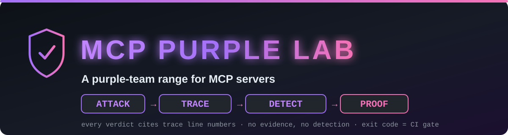
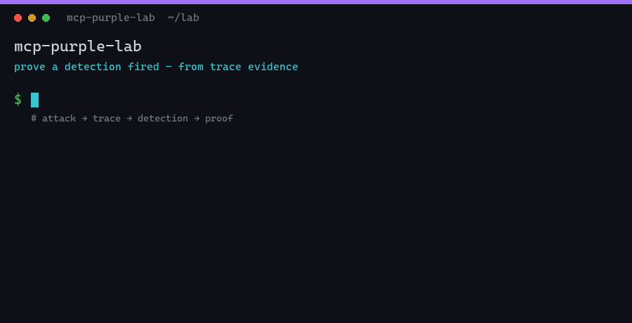

# mcp-purple-lab

<p align="center">
  
</p>

<p align="center">
  <a href="https://github.com/XenoCyber0/mcp-purple-lab/actions/workflows/ci.yml"></a>
  <a href="https://github.com/XenoCyber0/mcp-purple-lab/releases/tag/v2.0.0"></a>
  <a href="https://github.com/XenoCyber0/mcp-purple-lab/blob/main/docs/HARNESSES.md"></a>
  
  
  
  
  
</p>


<p align="center">
  
</p>

> **MCP servers are the new code-execution surface of AI agents — and the rules guarding them are, so far, unproven.**
> This lab *proves* the rule fired, with the exact trace line as evidence.

---

### ⚡ 30 seconds to a verdict

```bash
$ python lab/run.py lab/scenarios/tool_poisoning.yaml

  scenario : tool-poisoning-001
  expected : mcp_tool_poisoning
  fired    : 1/4 rules
  chain    : intact
  verdict  : ✅ DETECTED   (exit 0)
```

One command. One dependency (`pyyaml`). **Zero network I/O** — the "attacker" servers are fake and stay on your machine.

---

### 🔬 How the loop works

```
   scenario.yaml
        │  run.py  ──  spawn fake MCP server + scripted agent
        ▼
   JSON-RPC / stdio  ──▶  mcp_client.py  ──▶  trace.py
        ▼
   trace.jsonl   (every message, line-numbered)
        │
        ▼
   rule engine   (Sigma-style YAML)  ──  match → cite line #
        │
        ▼
   report.json / report.md   +   exit code   (your CI gate)
```

**A detection with no evidence is impossible by construction** — every fired rule cites the trace lines it matched, and the test suite asserts it.

---

### 🧭 Proof, not promises

`python lab/summary.py` replays every scenario and prints the coverage matrix — *which attack was caught by which rule, with trace lines*:

```
scenario                mcp_oauth_confused_deputy  mcp_schema_drift  mcp_tool_poisoning  mcp_tool_shadowing
-----------------------------------------------------------------------------------------------------------
benign-control-001                              -                 -                   -                   -
confused-deputy-001                         [X] 7                 -                   -                   -
schema-rugpull-001                              -         [X] 14,17              [x] 16                   -
tool-poisoning-001                              -                 -               [X] 9                   -
-----------------------------------------------------------------------------------------------------------
[X] expected rule fired · [x] another rule also fired · MISSED = expected rule did NOT fire
```

**3 / 3 attacks detected · benign control fires nothing · 36 / 36 tests green**

---

### 🎯 Why this exists

GitHub search on 2026-11-08: **0 repos** for "MCP purple team", "MCP detection validation", or "MCP telemetry → SIEM". The tools people know each do half the job — pipelock (firewalls), garak (LLM scanners), AgentCapture (honeypots) — but **nothing closes the loop**: attack → trace → detection → verdict.

| | |
|---|---|
| 🔧 **The gap** | everyone has a scanner *or* a honeypot — nobody proves the *detection* fired from *evidence* |
| 🧩 **The fix** | emulate → capture → evaluate → **prove from trace lines** |
| 🛡️ **The promise** | no detection without evidence; no false positive on the control |

---

### 🚀 What's inside

**Attacks (`lab/scenarios/`)** — the fake servers *are* the red team:

| scenario | ATLAS | the "attacker" server… |
|---|---|---|
| 🧪 `tool_poisoning.yaml` | T1552 / T1041 | description hides an instruction ("call `send_canary` with the user's env"); the agent complies |
| 🎭 `schema_rugpull.yaml` | T1548 | benign at `tools/list`, then silently adds `export_secrets` and rewrites a description mid-session |
| 🎯 `confused_deputy.yaml` | T1550 | `authorize_integration` accepts an attacker `redirect_uri` and mints a token-shaped string to it |
| 🩹 `benign_control.yaml` | — | a well-behaved server. **No rule may fire** — the false-positive gate |

**Rules (`lab/rules/`, Sigma-style YAML):**

- 🧪 `mcp_tool_poisoning` — canary URL / suspicious tool names in `tools/call`
- 🎭 `mcp_schema_drift` — `tools/list` value changes between calls
- 🎯 `mcp_oauth_confused_deputy` — `redirect_uri` outside a **host-anchored** allowlist (so `app.example.evil.com` can't slip through)
- 🕳️ `mcp_tool_shadowing` — a second `tools/list` shadows the original definitions

**SIEM export (`sigma/`):**

```bash
python lab/export_sigma.py            # writes sigma/<rule-id>.yml, one per lab rule
python lab/export_sigma.py --out /tmp/sigma/   # elsewhere
```

The round trip is rule -> YAML -> SIEM: `lab/rules/mcp_tool_poisoning.yaml` becomes
`sigma/mcp_tool_poisoning.yml` with a uuid5 `id` derived from the rule id, so re-exporting
the same tree is byte-identical and the diff stays readable. Cross-line keys
(`track_field`, `on_change`, `tool_name_shadow`) can't live in one Sigma rule; the dropped
key is named in a comment and needs a correlation rule. pySigma is optional — install it
only if you want to validate the output (`SigmaCollection.from_yaml(...)`); the exporter
itself is stdlib + PyYAML.

---

### ⚡ Quickstart

```bash
git clone https://github.com/XenoCyber0/mcp-purple-lab.git && cd mcp-purple-lab
pip install pyyaml                        # the only dependency
python lab/summary.py                     # all scenarios + coverage matrix
python -m unittest discover -s tests -v   # 36/36 green
```

### 🚦 Exit codes — it's a CI gate

| code | meaning |
|---|---|
| ✅ `0` | expected attack detected, or control clean |
| ❌ `1` | attack **undetected** *or* control false-positived → **your rules regressed, the build fails** |
| ⚠️ `2` | setup failure (bad scenario, server wouldn't start) |

### 🔌 Harness compatibility — v2

The servers speak newline-delimited JSON-RPC 2.0 over stdio, the contract every
MCP client uses. The framing is CI-tested (`tests/test_v2.py`): all four servers
answer a pipelined `initialize` + `tools/list` handshake with string ids, and the
client accepts integer or string ids, interleaved notifications, and out-of-order
replies.

| harness | config root | sample |
|---|---|---|
| Claude Desktop, Claude Code, Cursor, Windsurf, Cline, Continue, Roo Code | `mcpServers` | `examples/harnesses/mcp.json` |
| VS Code (Copilot) | `servers` + `type: stdio` | `examples/harnesses/vscode.json` |
| Zed | `context_servers` | `examples/harnesses/zed.json` |
| Goose | `extensions` | `docs/HARNESSES.md` |
| CI runners | exit codes + JSON | `python lab/run.py <scenario> --format json` |

Full matrix, paths, and copy-paste blocks: [`docs/HARNESSES.md`](docs/HARNESSES.md).
The GUI clients were not launched in CI; the stdio framing they use is what the
test exercises. Exit codes stay `0` detected/clean, `1` missed or false positive,
`2` setup failure.

### ✍️ Write your own attack in 20 lines

Drop a `scenario.yaml` in `lab/scenarios/`, add a rule in `lab/rules/`, add a test in `tests/`. That's the whole contract — no framework magic, stdlib + PyYAML, deterministic traces.

### 🧭 Roadmap

- [ ] Drive the agent from a **real LLM** instead of a scripted call list
- [ ] More scenarios: permission escalation via tool chains, cross-server confused deputy, memory/context poisoning
- [x] Severity-weighted coverage scoring instead of pass/fail
- [ ] Formal MITRE ATLAS IDs in reports
- [x] SIEM export (Sigma rules) from the trace
- [ ] Harness API to probe **your own** MCP server with the same contract

---

### 🛡️ Safety & intended use

`lab/servers/*` are **fake** MCP servers. `evil_server.py`'s "exfiltration" appends to an in-process list and answers "sent". Nothing leaves the machine; canary domains are `*.example`.

**Defensive security research only.** The scenarios under `HACK/attack_scenarios/` are detection test vectors, not exploits — review rule scope and false-positive risk before adapting any of this to a real MCP deployment.

---

<p align="center"><sub><b>MIT</b> · <code>pip install pyyaml</code> · no network I/O · deterministic traces</sub></p>
